By following this recipe you can make your own dial, to work as a computer input device or to be embedded in other prototypes.

## 1. Making the dial

**Step 1.** Gather some waste plastic.

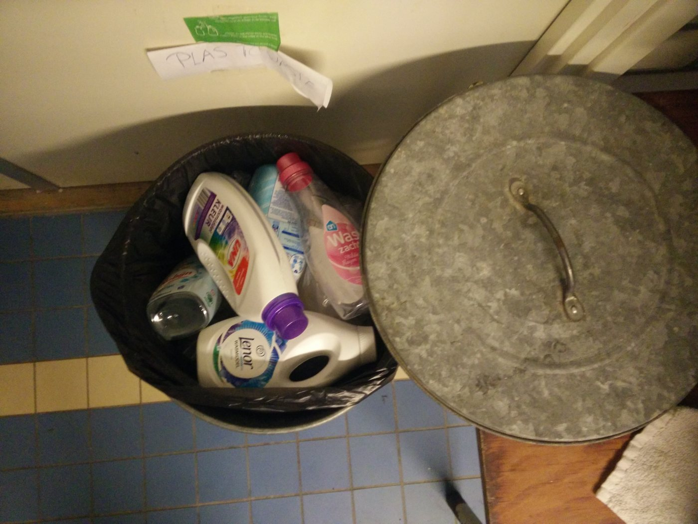

**Step 2.** Shred it into small flakes.

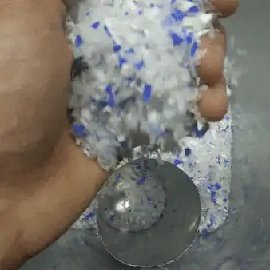

> A plastic shredder is available at the faculty. Ask the workshop staff about access.

**Step 3.** Melt it in an oven, at 210 °C for HDPE.

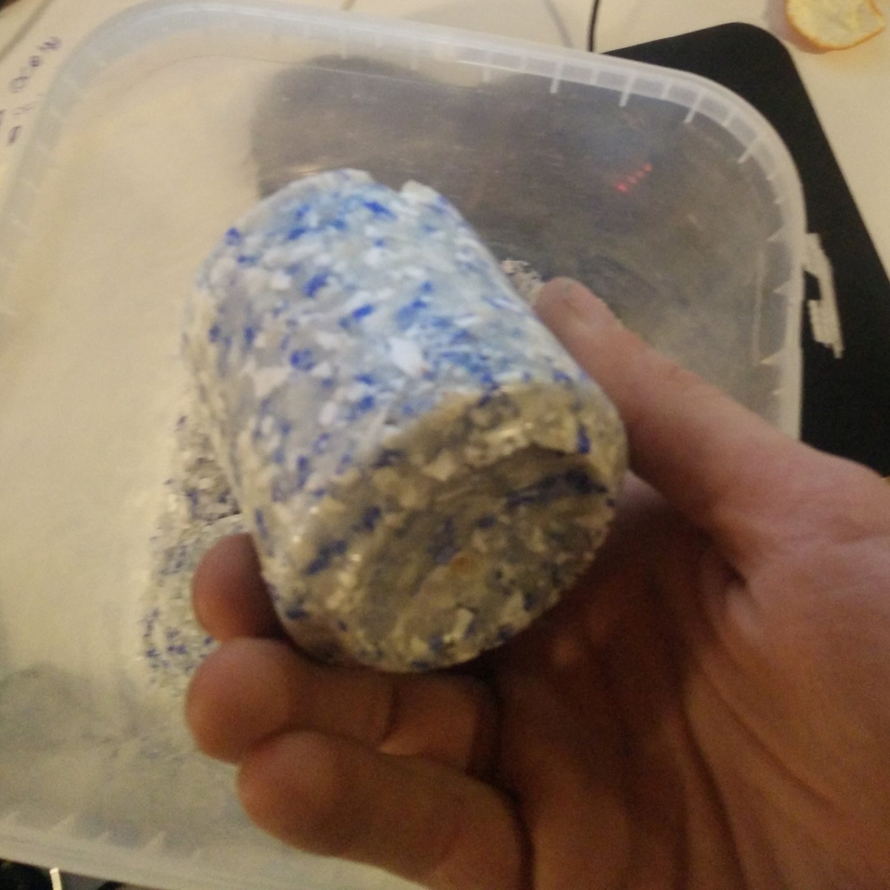

**Step 4.** Press it into a mould. I used an old beer can.


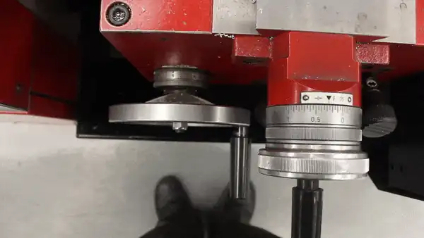

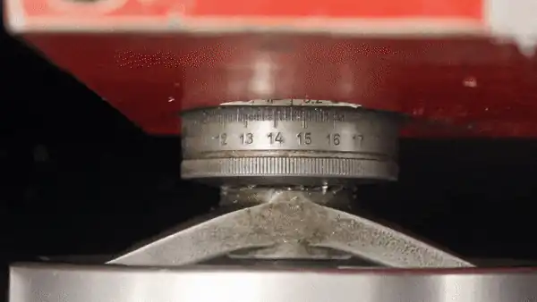

**Step 5.** Turn the parts to the desired dimensions.

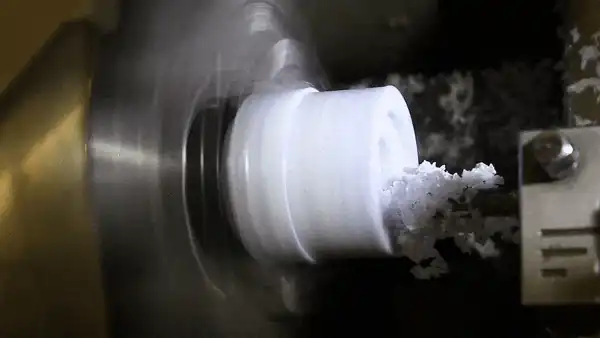

**Step 6.** Turn and mill the aluminium part.


It is a nice finishing touch to sandblast the aluminium part. This gets rid of the machining marks.

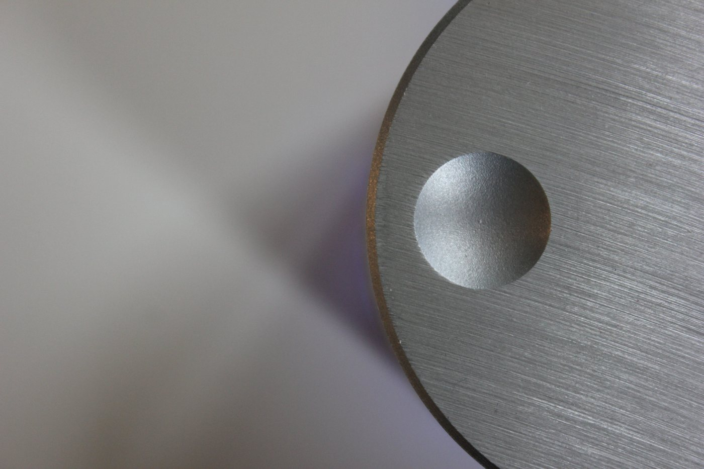

## 2. Electronics

**Step 1.** Follow the schematic below to assemble the electronics: a Digispark board, a rotary encoder and a ring of LEDs.

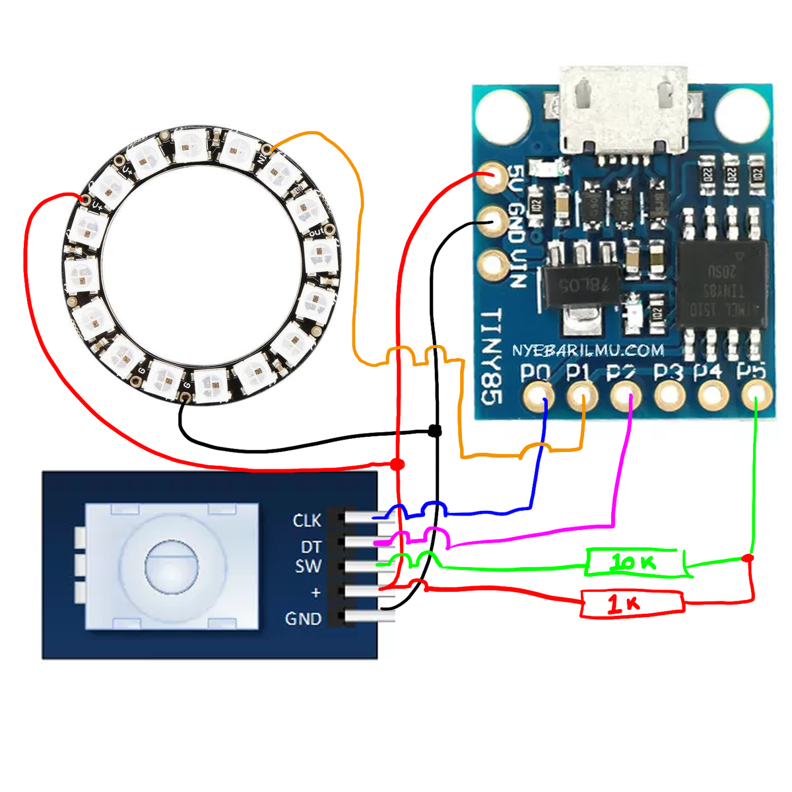

**Step 2.** Place the components in the plastic housing.

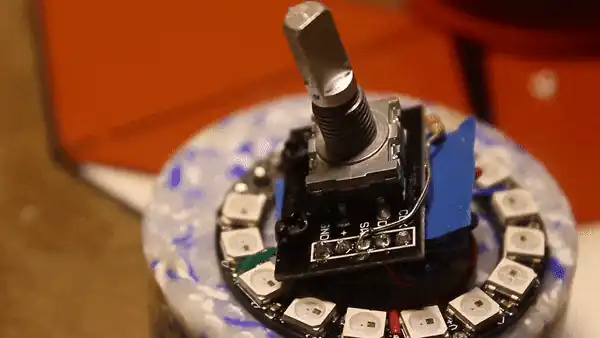

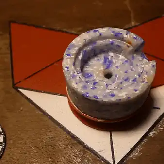

## 3. Code

**Step 1.** Add the board to Arduino. Open the Arduino IDE, go to *Preferences* and paste this address in *Additional boards manager URLs*:

```
http://digistump.com/package_digistump_index.json
```

Then open the *Boards Manager* and install the Digispark boards.

**Step 2.** Upload the code to the Digispark.

```cpp
// see tutorial at http://learn.adafruit.com/trinket-usb-volume-knob
#include <Adafruit_NeoPixel.h>
#define PIXEL_COUNT 15
#define PIXEL_PIN    1
Adafruit_NeoPixel strip = Adafruit_NeoPixel(PIXEL_COUNT, PIXEL_PIN, NEO_GRB + NEO_KHZ800);

#include "TrinketHidCombo.h"
#define PIN_ENCODER_A 0
#define PIN_ENCODER_B 2
#define TRINKET_PINx  PINB
#define PIN_ENCODER_SWITCH 5
int state = 1;
static uint8_t enc_prev_pos   = 0;
static uint8_t enc_flags      = 0;
static char    sw_was_pressed = 0;
int i=0;
int c=0;
void setup()
{
  strip.begin();
  strip.show(); // Initialize all pixels to 'off'
  colorWipe(strip.Color(0,0 ,200), 50);
  // set pins as input with internal pull-up resistors enabled
  pinMode(PIN_ENCODER_A, INPUT);
  pinMode(PIN_ENCODER_B, INPUT);
  digitalWrite(PIN_ENCODER_A, HIGH);
  digitalWrite(PIN_ENCODER_B, HIGH);

  pinMode(PIN_ENCODER_SWITCH, INPUT);
  // the switch is active-high, not active-low
  // since it shares the pin with Trinket's built-in LED
  // the LED acts as a pull-down resistor
  digitalWrite(PIN_ENCODER_SWITCH, HIGH);
  TrinketHidCombo.begin(); // start the USB device engine and enumerate
  // get an initial reading on the encoder pins
  if (digitalRead(PIN_ENCODER_A) == LOW) {
    enc_prev_pos |= (1 << 0);
  }
  if (digitalRead(PIN_ENCODER_B) == LOW) {
    enc_prev_pos |= (1 << 1);
  }
}

void loop()
{

  int8_t enc_action = 0; // 1 or -1 if moved, sign is direction

  // note: for better performance, the code will now use
  // direct port access techniques
  // http://www.arduino.cc/en/Reference/PortManipulation
  uint8_t enc_cur_pos = 0;
  // read in the encoder state first
  if (bit_is_clear(TRINKET_PINx, PIN_ENCODER_A)) {
    enc_cur_pos |= (1 << 0);
  }
  if (bit_is_clear(TRINKET_PINx, PIN_ENCODER_B)) {
    enc_cur_pos |= (1 << 1);
  }

  // if any rotation at all
  if (enc_cur_pos != enc_prev_pos)
  {
    if (enc_prev_pos == 0x00)
    {
      // this is the first edge
      if (enc_cur_pos == 0x01) {
        enc_flags |= (1 << 0);
      }
      else if (enc_cur_pos == 0x02) {
        enc_flags |= (1 << 1);
      }
    }

    if (enc_cur_pos == 0x03)
    {
      // this is when the encoder is in the middle of a "step"
      enc_flags |= (1 << 4);
    }
    else if (enc_cur_pos == 0x00)
    {
      // this is the final edge
      if (enc_prev_pos == 0x02) {
        enc_flags |= (1 << 2);
      }
      else if (enc_prev_pos == 0x01) {
        enc_flags |= (1 << 3);
      }

      // check the first and last edge
      // or maybe one edge is missing, if missing then require the middle state
      // this will reject bounces and false movements
      if (bit_is_set(enc_flags, 0) && (bit_is_set(enc_flags, 2) || bit_is_set(enc_flags, 4))) {
        enc_action = 1;
      }
      else if (bit_is_set(enc_flags, 2) && (bit_is_set(enc_flags, 0) || bit_is_set(enc_flags, 4))) {
        enc_action = 1;
      }
      else if (bit_is_set(enc_flags, 1) && (bit_is_set(enc_flags, 3) || bit_is_set(enc_flags, 4))) {
        enc_action = -1;
      }
      else if (bit_is_set(enc_flags, 3) && (bit_is_set(enc_flags, 1) || bit_is_set(enc_flags, 4))) {
        enc_action = -1;
      }

      enc_flags = 0; // reset for next time
    }
  }

  enc_prev_pos = enc_cur_pos;

  if (enc_action > 0) {
    i=i++;
    if (i == 16){
      i=0;
    }
    if (state == 1) {
      TrinketHidCombo.pressMultimediaKey(MMKEY_VOL_DOWN);
      //strip.setPixelColor(i, c);
      //strip.setPixelColor(i-1, c);
    }
    if (state == 2) {
      TrinketHidCombo.pressKey(0, KEYCODE_ARROW_LEFT);
      TrinketHidCombo.pressKey(0, 0);
      //strip.setPixelColor(i, c);
      //strip.setPixelColor(i-1, c);
    }
    if (state == 3) {
      TrinketHidCombo.pressKey(0, KEYCODE_ARROW_UP);
      TrinketHidCombo.pressKey(0, 0);
      //strip.setPixelColor(i, c);
      //strip.setPixelColor(i-1, c);
    }
  }
  else if (enc_action < 0) {
    if (state == 1) {
      TrinketHidCombo.pressMultimediaKey(MMKEY_VOL_UP);
      //strip.setPixelColor(i, c);
      //strip.setPixelColor(i+1, c);
    }
    if (state == 2) {
      TrinketHidCombo.pressKey(0, KEYCODE_ARROW_RIGHT);
      TrinketHidCombo.pressKey(0, 0);
      //strip.setPixelColor(i, c);
      //strip.setPixelColor(i+1, c);
    }
    if (state == 3) {
      TrinketHidCombo.pressKey(0, KEYCODE_ARROW_DOWN);
      TrinketHidCombo.pressKey(0, 0);
      //strip.setPixelColor(i, c);
      //strip.setPixelColor(i+1, c);
    }

  }

  // remember that the switch is active-high
  if (analogRead(0) < 950 )
  {
    if (sw_was_pressed == 0) // only on initial press, so the keystroke is not repeated while the button is held down
    {
      state = state + 1;
      if (state == 4) {
        state = 1;
      }
      delay(5); // debounce delay
    }
    if (state == 1 ) {
      colorWipe(strip.Color(0,0 ,200), 50);
      //colorWipe(strip.Color(0, 0, 0), 50);
    }
    if (state == 2 ) {
      colorWipe(strip.Color(0, 120,120), 50);
      //colorWipe(strip.Color(0, 0, 0), 50);
    }
    if (state == 3 ) {
      colorWipe(strip.Color(120 , 0, 120), 50);
    //colorWipe(strip.Color(0, 0, 0), 50);
    }

    sw_was_pressed = 1;

  }
  else
  {
    if (sw_was_pressed != 0) {
      delay(5); // debounce delay
    }
    sw_was_pressed = 0;
  }

  TrinketHidCombo.poll(); // check if USB needs anything done

}

void colorWipe(uint32_t c, uint8_t wait) {
  for (uint16_t i = 0; i < strip.numPixels(); i++) {
    strip.setPixelColor(i, c);
    strip.show();
    delay(wait);
  }
}
```

## 4. Enjoy!

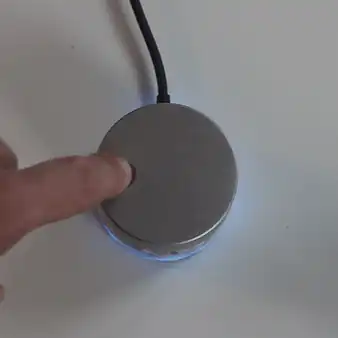

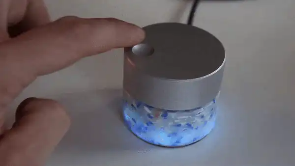

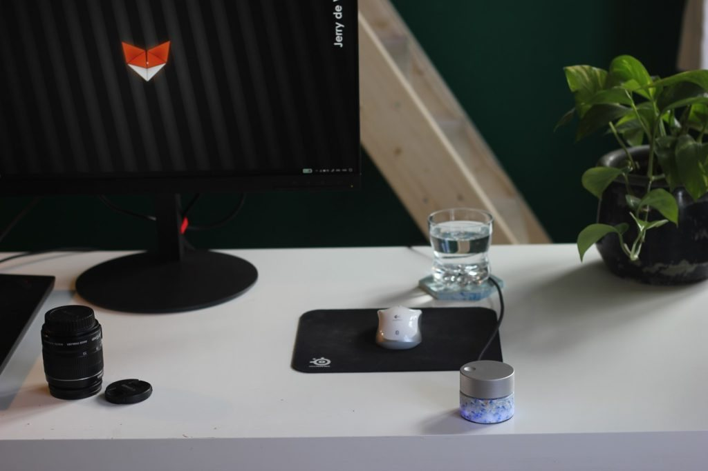

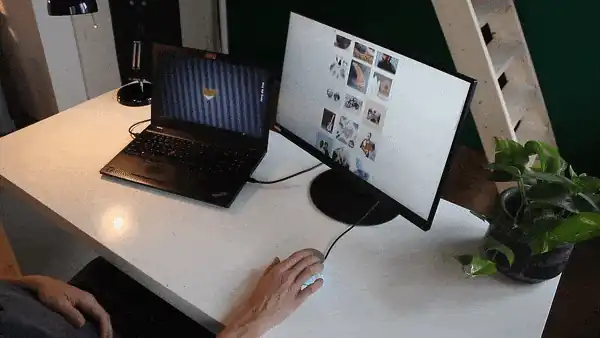
