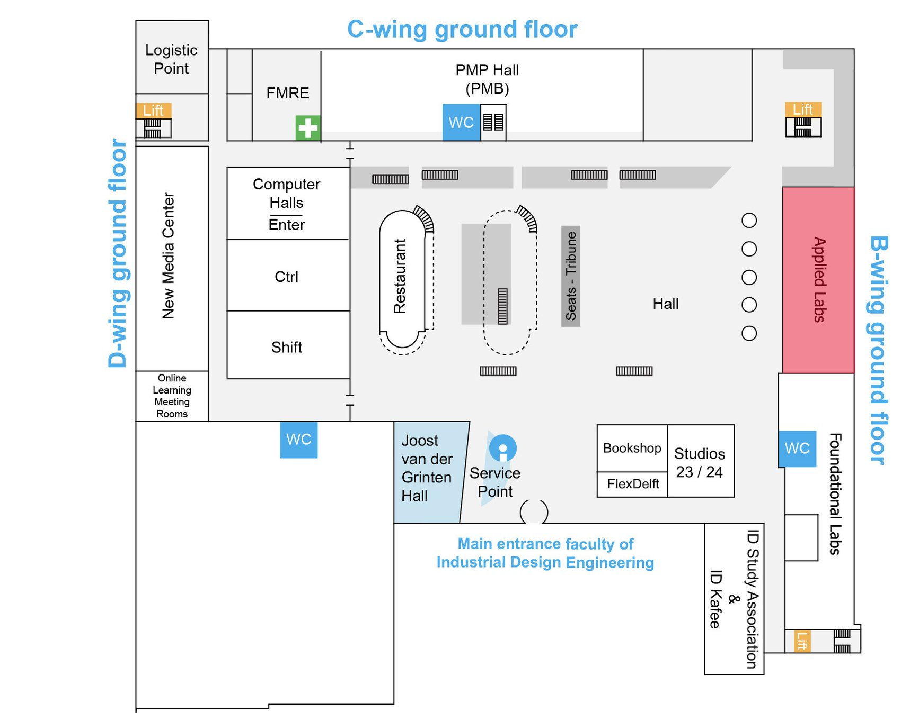

The Applied Labs at the IDE faculty provide space and facilities for student and research projects that need a dedicated, more controlled space to develop and test prototypes.

You may request a spot there if you are working on a large project. You can also stop by for some ad-hoc advice on building prototypes from the lab staff, who you can often find there.

