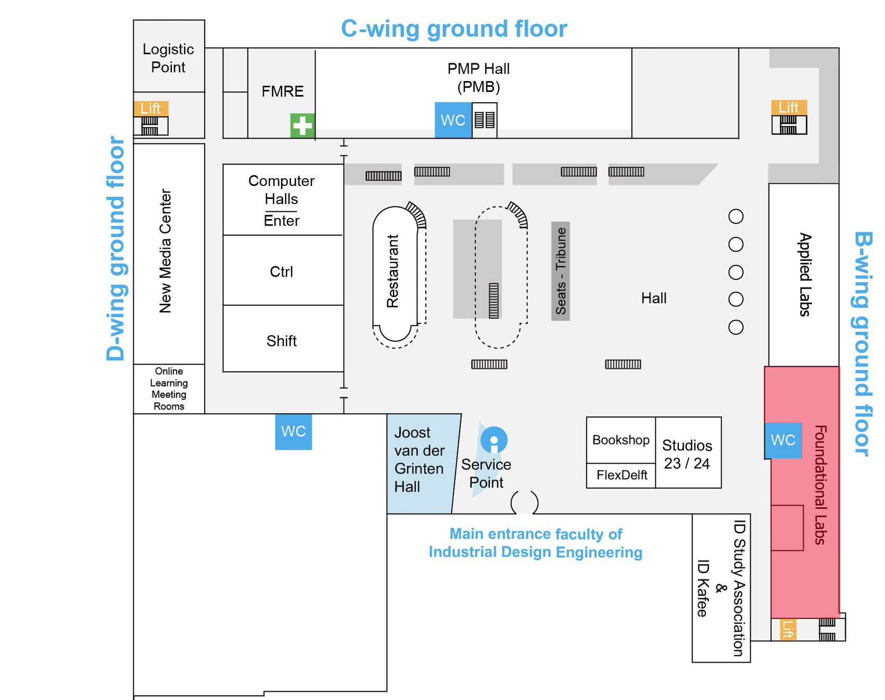

The Foundational Labs (also known as the DE-Labs) contain specialised research facilities for testing materials, parts and products. The labs consist of separate rooms:

- the **CHEM-Lab**, for controlled and safe experiments involving aggressive chemicals
- the **MAT-Lab**, for large- and small-scale materials testing, used mainly, but not only, for plastics and natural materials
- the **Digital Fabrication Lab**, with advanced 3D printing facilities
- the **M-Lab**, to work on parts and products
- the CNC knitting machine, sewing machines and other facilities that support research on e-textiles

## Practicalities

- The Foundational Labs are on the ground floor of the IDE building, to the right of the main entrance (see the plan below).
- The labs are mainly intended for research, but you can approach the researchers involved directly, and in many cases agree on some form of supervised access to the facilities. This is not off-the-shelf education, so be explicit about your motivation and plans. It could also be the prelude to an interesting graduation assignment.
- The Foundational Labs are often empty. Staff at the neighbouring [Applied Labs](../ide-applied-labs/) can help you get in touch with the right person.

