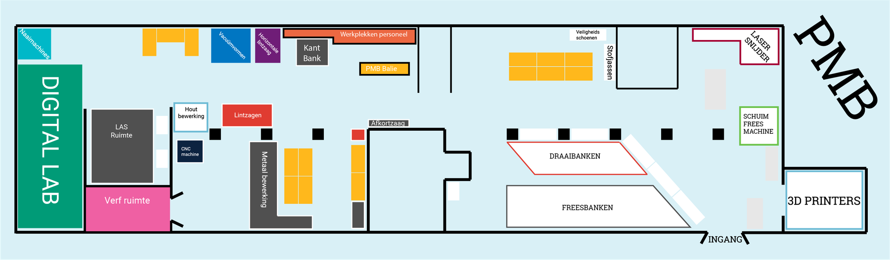

The Model Making and Machine Lab (PMB) at the IDE faculty is a large workshop with many machines and facilities for making prototypes and models. Most PMB facilities are on the ground floor of the faculty, across the hall from the main entrance. There is also a workplace in the basement of the building (the *flexruimte*), next to the "Kuil" (the pit). The materials shop is located there too.

## Facilities

- 3D printing (Ultimaker printers, and several recently purchased Bambu Lab printers)
- Laser cutting (bed of 120 × 70 cm)
- Foam milling
- Lathe (aluminium, steel, wood, some plastics)
- Milling (aluminium, steel, wood, some plastics)
- Sheet steel processing (measuring, cutting, bending, drilling, connecting)
- (Band) sawing (aluminium, steel, wood, some plastics)
- Press drilling (aluminium, steel, wood, some plastics)
- Sanding (aluminium, steel, wood, some plastics)
- Vacuum forming
- Sewing
- Digital Lab for working with electronics
- Spray painting, in a room made for it (*verfruimte* on the plan)
- Sandblasting
- Welding (currently no training available)
- CNC milling (currently no training available)
- Materials shop in the basement
- The plastic shredder is currently also placed at the PMB

## Safety and house rules

- The workshop is for IDE students and employees, unless other arrangements are made.
- A protective coat, steel-toe safety shoes and safety glasses are mandatory for many machines. You can borrow them at the PMB.
- Leave a clean workspace.
- Always follow the instructions of the PMB employees and student assistants.

## Training

Many machines require you to follow a training workshop first (lathe, milling, working with sheet metal and so on). It works best to form a small group of 2 to 6 interested people and ask at the PMB about possible dates. After the training you may use those machines on your own.

For some machines and facilities, such as CNC milling and welding, the PMB does not offer workshops at the moment. If you can show expertise, or have a serious ambition for those skills, the PMB staff can think along in finding ways to support you.

## Tips

- The PMB can seem intimidating. Don't be put off: the people working there are fantastic, have a lot of valuable know-how and love to think along with students.
- Go prepared. Know what you need, bring drawings or examples of what you intend to make, ask clear questions, read the instructions beforehand and respect the rules.
- It can be very busy. Be prepared to wait, or ask what would be a quieter moment to return.
- Get to know the people who work there. It helps to understand who is the specialist in what.
- The big table next to the laser cutter is where the PMB staff take their breaks. Don't use it for prototyping, and if you see a meeting or a coffee break there, ask whether you are disturbing before making elaborate requests.
- Much more information is on the PMB website. It is being updated, and some of it is only available in Dutch.
